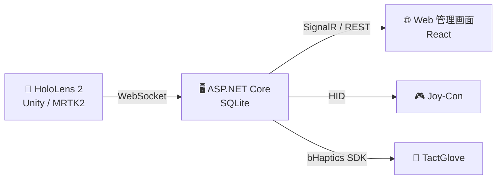

<!-- Header -->

  

  

---

## 👋 About me

- 🥽 **MR × 触覚** で「手に取って感じられる教材」を研究している大学院生です
- 🧤 HoloLens 2 と触覚グローブ（bHaptics TactGlove）・Joy-Con を組み合わせたシステムを開発中
- 🌱 M5Stack を使った IoT や、スマホで動く WebAR も作っています
- 💬 Ask me about: **Unity / MRTK, ASP.NET Core, React, M5Stack**

## 🔭 Now

- 📝 研究システムの仕上げと、修士論文の執筆
- 🧤 触覚フィードバックの設計・調整

## 🔬 Research

HoloLens 2 と触覚デバイスを使った、**手で触れて学べる MR 教材**を研究しています。

<!-- ===== Research の詳細（論文発表後に公開する場合は、この行と下の「Research 詳細ここまで」の行を消す）=====

HoloLens 2 で火成岩 6 種の 3D モデルを手に取って観察できる授業支援システムです。
指先が岩石に触れると、岩石の組成（珪長質〜苦鉄質）に応じた振動が触覚グローブと Joy-Con に返ってきます。
教員は Web 管理画面から表示する岩石を割り当て、受講者ごとの操作時間・観察時間を分析できます。

===== Research 詳細ここまで ===== -->

## 🛠 Tech Stack

   
  

| 分野 | 使っている技術 | やったこと |
|---|---|---|
| 🥽 MR | Unity, MRTK2, C# | HoloLens 2 アプリ開発、指先と 3D モデルの接触判定 |
| 🖥 Server | ASP.NET Core 8, EF Core, SQLite | REST API・WebSocket・SignalR でのリアルタイム連携 |
| 🌐 Web | React, TypeScript, Vite | 教員向け管理画面、ログ分析画面 |
| 🧤 Haptics | bHaptics SDK, HidSharp | 触覚グローブ・Joy-Con の振動制御 |
| 🌱 IoT | M5Stack Core2, C++ (PlatformIO) | 温湿度・気圧センサーの Web モニター |
| 📱 WebAR | glTF, マーカー型 AR | ブラウザで動く AR コンテンツ |

<!-- ===== Projects（公開できる状態になったら、この行と下の「Projects ここまで」の行を消すと表示されます）=====

## 🚀 Projects

<table>
  <tr>
    <td width="50%" valign="top">
      <h3>🥽 HoloClass <code>research</code></h3>
      HoloLens 2 で火成岩の 3D モデルを手に取って観察できる授業支援システム。岩石の組成の違いを、触覚グローブと Joy-Con の振動で感じられる。教員は Web 管理画面から表示内容の割り当てと観察ログの分析ができる。
        
      
      
      
    </td>
    <td width="50%" valign="top">
      <h3>🌱 <a href="https://github.com/Ryoishimura/SmartAgricultureInShiramine">SmartAgricultureInShiramine</a></h3>
      M5Stack Core2 と ENV IV ユニットで温度・湿度・気圧を計測。本体画面に表示しつつ、Wi-Fi 経由のブラウザからも確認できるセンサー Web モニター。
        
      
      
    </td>
  </tr>
  <tr>
    <td width="50%" valign="top">
      <h3>🏔 <a href="https://github.com/Ryoishimura/HakusanWebAr">HakusanWebAr</a></h3>
      白山をテーマにした WebAR。マーカーにスマホをかざすと 3D モデルが現れる。アプリのインストール不要でブラウザだけで動く。
        
      
      
    </td>
    <td width="50%" valign="top">
      <h3>💼 <a href="https://github.com/Ryoishimura/portfolio">portfolio</a></h3>
      React で作ったポートフォリオサイト。
        
      
      
    </td>
  </tr>
</table>

===== Projects ここまで ===== -->

## 📊 GitHub Stats

  
  

  <picture>
    <source media="(prefers-color-scheme: dark)" srcset="https://raw.githubusercontent.com/Ryoishimura/Ryoishimura/output/github-snake-dark.svg" />
    
  </picture>

<!-- Footer -->

  

